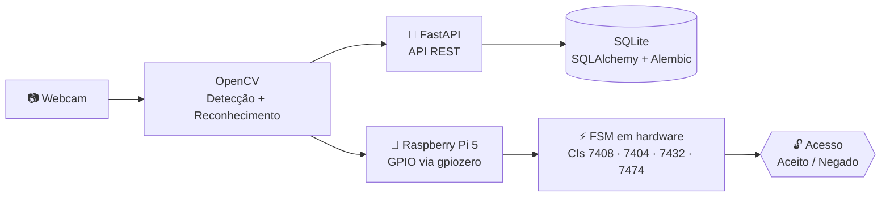
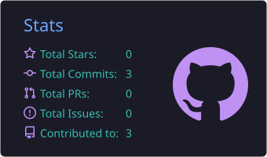
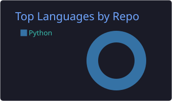
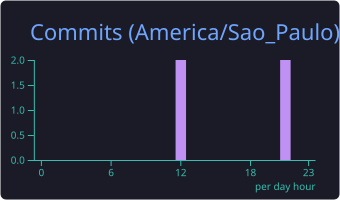

<!-- Header animado -->
<div align="center">



<a href="https://git.io/typing-svg">
  
</a>

<br/>


</div>

---

## 👨‍💻 Sobre mim

```python
class Henrique:
    nome      = "Henrique Gabriel Otfinoski"
    formacao  = "Ciência da Computação (cursando)"
    foco      = ["Backend", "Frontend", "IoT", "Visão Computacional"]
    linguagens = ["Java", "C++", "Python"]
    aprendendo = ["Arquitetura de Software", "Docker", "Algoritmos & Estruturas de Dados"]
    objetivo  = "Construir software que conversa com o mundo físico 🚀"
```

---

## 🚀 No que estou trabalhando

| | Foco | Detalhes |
|:-:|---|---|
| 💻 | **Fundamentos de linguagens** | Aprofundando **Java** e **C++**, com foco em algoritmos e resolução de problemas |
| 🏗️ | **Engenharia de Software** | Conceitos de full stack, APIs REST e arquitetura de software |
| 🧩 | **Programação competitiva** | Treinando lógica com desafios e exercícios |
| 🤖 | **Projeto SAFE (PI-IV)** | Controle de acesso com reconhecimento facial rodando em **Raspberry Pi 5**, integrado a uma FSM em hardware |

---

## 🔐 Projeto em destaque: SAFE

> Sistema de controle de acesso por **reconhecimento facial** que une software e hardware digital.



| Camada | Tecnologias |
|---|---|
| **Visão computacional** |  |
| **API / Backend** |     |
| **Banco de dados** |  |
| **Infra & Deploy** |   |
| **Hardware** |   |
| **Simulação** |   |
| **Testes** |   |

---

## 🛠️ Tech Stack

### Linguagens
<p>
  
</p>

### Backend, Dados & APIs
<p>
  
</p>

### DevOps, Ferramentas & Ambiente
<p>
  
</p>

### Visão Computacional, Eletrônica & Design
<p>
  
</p>

### Nível de familiaridade

| Tecnologia | Nível |
|---|---|
| ☕ **Java** |  |
| ⚙️ **C++** |  |
| 🐍 **Python** |  |
| 🌐 **FastAPI / REST** |  |
| 🐳 **Docker** |  |
| 🗃️ **SQL / SQLite** |  |

> 💡 Os percentuais são uma estimativa pessoal, ajuste como achar justo.

---

## 📊 GitHub Stats

<div align="center">






<br/>


</div>

### 🐍 Contribuições

<div align="center">
  
</div>

---

## 📌 Projetos em destaque

| Projeto | Descrição | Stack |
|---|---|---|
| [🔐 **SAFE**](https://github.com/HenriqueOtfinoski/SAFE) | Controle de acesso por reconhecimento facial integrado a uma FSM em hardware (PI-IV) | `Python` `FastAPI` `OpenCV` `Docker` `Raspberry Pi 5` |

---

## 🎯 Metas

- [x] Fundamentos de **Java** e **C++**
- [x] Primeiro projeto integrando **software + hardware** (SAFE)
- [ ] Dominar **estruturas de dados e algoritmos**
- [ ] Aprofundar **Docker** e **CI/CD**
- [ ] Construir um projeto **full stack** completo com front-end
- [ ] Contribuir com projetos open source

---

## 🤝 Vamos nos conectar

<div align="center">

[](https://www.linkedin.com/in/henrique-otfinoski-963328366/)
[](https://www.instagram.com/henrique_otfinoski/)
[](mailto:henriquegabrielotfinoski@gmail.com)

<br/>


</div>
